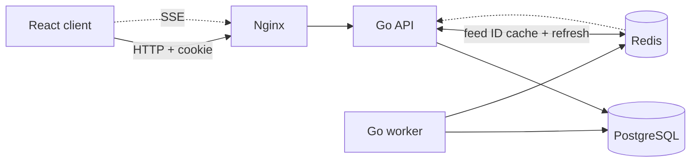
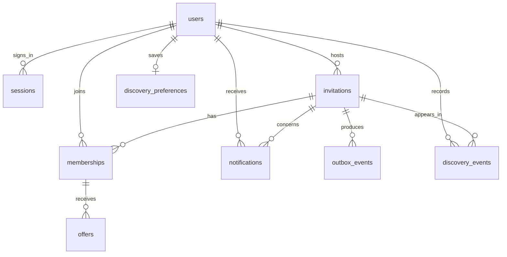
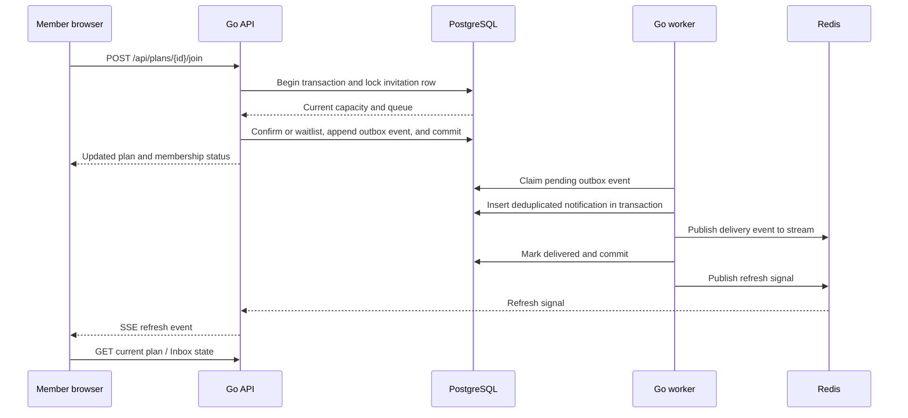

# Architecture design

OneMore coordinates a finite number of spaces in a plan. The design keeps allocation in PostgreSQL transactions and uses Redis for short-lived caching and refresh delivery.

## Components



| Component | Responsibility |
| --- | --- |
| React client | Profile access, discovery, plan actions, and Inbox; reloads current state when it receives a refresh event. |
| Nginx | Serves the built client and proxies API requests and the SSE connection. |
| Go API | Validates requests, authenticates sessions, applies migrations, serves plan and discovery data, and runs transactions for membership changes. |
| Go worker | Expires offers and retries pending outbox events. Multiple workers can run concurrently. |
| PostgreSQL | Durable source for users, plans, memberships, offers, notifications, outbox events, and discovery data. |
| Redis | Five-second feed ID cache, refresh Pub/Sub, and delivery stream. It does not hold authoritative capacity state. |

## Data model



The SQL definitions are in [`internal/core/migrations`](../internal/core/migrations). `schema_migrations` records applied versions. API startup takes a PostgreSQL advisory lock so two API processes cannot apply the same migration at once. Migrations run in transactions and are forward-only.

## Allocation and waitlist

Every join, leave, offer response, cancellation, and expiry transaction locks the invitation row before changing memberships or offers. The invariant is:

```text
confirmed memberships + active reserved offers <= spaces
```

`spaces` excludes the host. A successful join either confirms a person immediately or places them on the waitlist. When a place opens, the earliest waitlisted membership gets an active offer. The offer reserves the space for ten minutes; the next person cannot claim that reserved space. Accepting changes the membership to confirmed. Declining or expiry releases the reservation and advances the queue. The server enforces deadlines using database time and returns current plan state after a successful action.



The diagram shows the shared pattern. Offer creation also occurs when a confirmed member leaves or an earlier offer expires. The worker polls durable rows so a restart does not lose expiry work.

## Delivery and failure behavior

A business change and its outbox row commit in the same PostgreSQL transaction. Publishing to Redis and committing PostgreSQL cannot be atomic. If a worker publishes and dies before recording delivery, another worker republishes the same event ID. Notification insertion uses that ID as a unique key, so duplicate stream entries produce one persisted notification. Other consumers of the stream must deduplicate by event ID too.

If Redis is unavailable, capacity decisions continue against PostgreSQL and outbox rows remain pending. After Redis returns, workers retry them. The browser's SSE connection sends periodic refresh events in addition to Pub/Sub signals, then fetches current state from the API; a missed signal does not make stale event data authoritative.

## Read path and discovery

The chronological feed caches a list of plan IDs for five seconds. Plan details, live capacity, and the viewer's membership are read from PostgreSQL in a batch. This avoids up to 25 sequential detail lookups per page. The **For you** view scores up to 200 upcoming candidates and returns the best 24 using interests, area, availability, recent interactions, and open spaces. It is an explainable rule-based ranking; [discovery notes](discovery.md) list the weights and measurement limits.

## Operational boundaries

- Local Compose binds the web, API, PostgreSQL, and Redis ports to `127.0.0.1`.
- The production overlay uses Caddy for HTTPS, secure cookies, and OIDC sign-in; local password registration is disabled there.
- The [operations dashboard](operations.md) displays per-process latency and error counters plus shared database and outbox measurements.
- Integration tests use a database ending in `_test`; the [process recovery test](operations.md#failure-and-recovery-exercise) exercises two APIs, two workers, a last-space race, Redis failure, and replay after a worker crash.

## Tradeoffs and limits

The five-second cache reduces feed ID queries while leaving plan detail current. The personalized view has a 200-candidate bound, which can exclude a later plan that would score well. SSE messages carry refresh signals rather than full state, adding a read after each signal but simplifying recovery. Metrics are local to each API process; the dashboard is not an aggregated monitoring system.
